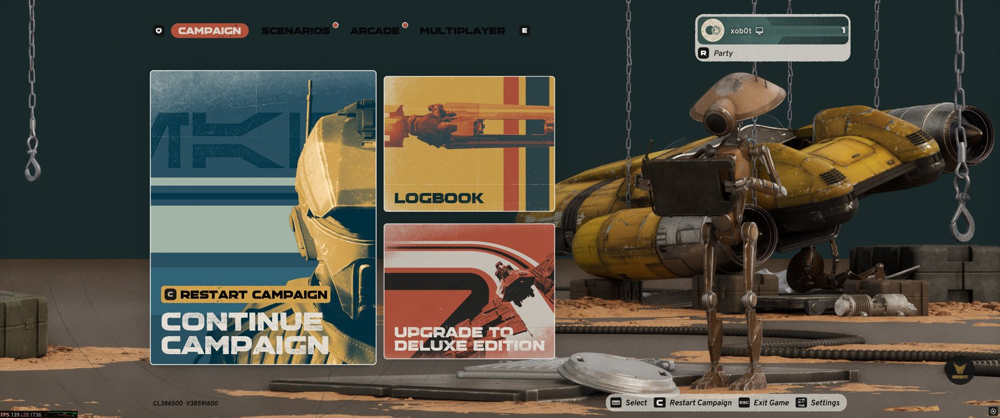
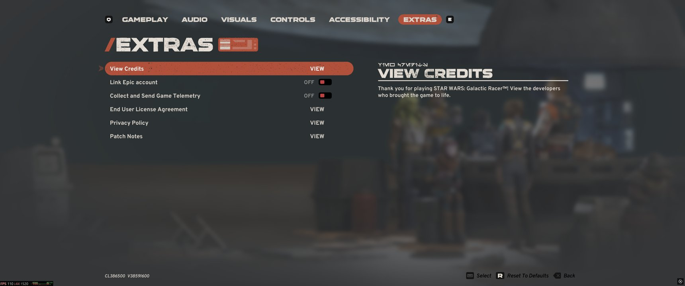

# DarkMode for STAR WARS Galactic Racer

The game's menus are bright white. This mod makes them dark.

| Before | After |
|---|---|
|  |  |

| Settings | Scenarios |
|---|---|
|  |  |

## What it changes

- **Main menu backdrop:** the white photo studio behind the menus becomes a dark teal wall with a dark
  brown floor.
- **Menus and dialogs:** white panels, cards and backgrounds become dark grey, and dark text on them
  becomes the game's own cream text color.
- **Left alone:** artwork, character portraits, icons, colored highlights and the in-race HUD.

It recolors the shared building blocks (panels, cards, text) rather than individual screens, so menus
that weren't tested should be covered too.

## Requirements

- STAR WARS Galactic Racer on Steam
- [UE4SS](https://github.com/UE4SS-RE/RE-UE4SS/releases) v4.0.0 with the Galactic Racer signatures. The
  game isn't supported by stock UE4SS yet, so copy the
  [`UE4SS_Signatures` folder](https://github.com/xob0t/RE-UE4SS/tree/add-star-wars-galactic-racer-config/assets/CustomGameConfigs/Star%20Wars%20Galactic%20Racer)
  next to `UE4SS.dll` ([UE4SS PR #1502](https://github.com/UE4SS-RE/RE-UE4SS/pull/1502)).

[UE4SS Galactic Racer Edition](https://www.nexusmods.com/starwarsgalacticracer/mods/2), a UE4SS fork on
Nexus Mods, might also work, but it hasn't been tested with this mod.

## Install

1. Download `DarkMode-vX.Y.Z.zip` from [Releases](../../releases).
2. Extract it into `STAR WARS Galactic Racer\Griffin\Binaries\Win64`. This creates
   `ue4ss\Mods\DarkMode`.
3. Start the game.

To update, extract the new version over the old one. To uninstall, delete `ue4ss\Mods\DarkMode`.

## Changing the colors

Open the files in `ue4ss\Mods\DarkMode\Scripts` in a text editor. Colors are linear RGB values from 0 to 1.

- `main.lua`, `CONFIG`: the backdrop (`wall`, `floor`) and how much the light is dimmed
  (`sun_scale`). Set `ui = false` to darken only the backdrop and leave the menus as they are.
- `ui.lua`, `CFG`: the menus (`panel`, `outline`, `text`).

## Good to know

- The first time you open a screen the mod hasn't seen before, it may show white for a moment. The mod
  remembers it (in `Scripts\learned.txt`) and the screen opens dark from then on.
- It costs about 0.1 ms per frame.
- Not tested yet: race loading screens, the pause menu during a race, race results and online lobbies.

## How it works

The game has no dark theme or color palette to switch, so the mod classifies widgets by type (panel,
outline, text, artwork) and recolors them. To avoid white flashes it also patches the templates new
screens are built from, and hooks the game's color setters to catch hover and focus changes. Details,
findings and UE4SS notes are in [docs/FINDINGS.md](docs/FINDINGS.md).
