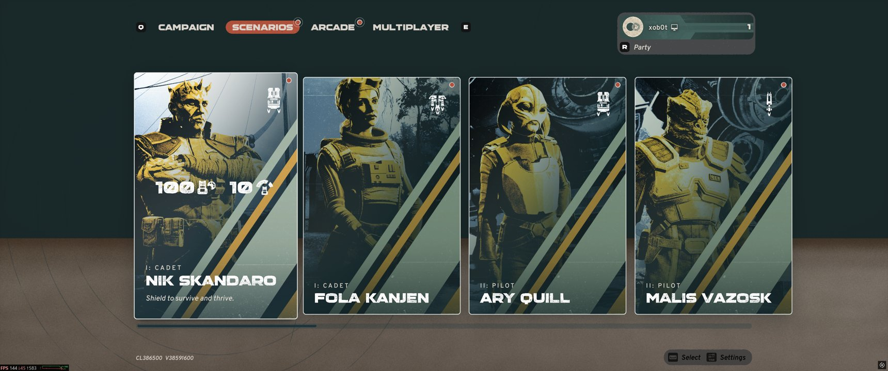

# DarkMode for STAR WARS Galactic Racer

A UE4SS Lua mod that makes the game's very bright, white front end dark: the 3D backdrop behind the
menus and the UI itself (panels, cards, dialogs, text).

| Before | After |
|---|---|
|  |  |

| Settings | Scenarios |
|---|---|
|  |  |

## Requirements

- STAR WARS Galactic Racer (Steam build 26133805, UE 5.7.4)
- Official [RE-UE4SS](https://github.com/UE4SS-RE/RE-UE4SS) v4.0.0 plus the Galactic Racer custom config
  ([UE4SS PR #1502](https://github.com/UE4SS-RE/RE-UE4SS/pull/1502)): copy the five
  `UE4SS_Signatures/*.lua` files next to `UE4SS.dll`.

## Install

Copy `mod/DarkMode` into `Griffin/Binaries/Win64/ue4ss/Mods/` and create an empty `enabled.txt` in it
(or add `DarkMode : 1` to `mods.txt`).

## What it does

**3D backdrop** (`main.lua`): the menus are drawn over a white "photo studio" set in the `L_FrontEnd`
level. The mod tints that set instead of removing it (removing it leaves black holes in the floor):

- `SM_FrontEndStudio_01` slot 1 (unlit cyclorama wall) → dark teal
- `SM_FrontEndStudio_01` slot 0 (lit floor) → dark brown
- `SM_LiminalSphereBackground` (unlit cream spheres) and `BP_FogPlane_VFX_C` (white haze cards) → hidden
- the lighting rig's directional light → 20%

**UI** (`ui.lua`): the game has no theme or palette, so the mod recolors by component type rather than
per menu. Light "paper" panels, tile and card bases, scrims and vignettes become dark. Light outlines
become muted. Dark text, dark tint wrappers and dark rich text on those surfaces become the game's own
cream text color. Artwork, thumbnails, icons, decoration and colored panels are left alone. The work is
time-sliced over frames (about 0.1 ms per frame on average), so it doesn't cause hitches.

To avoid a white flash when a screen opens, every decision is also applied to the widget class's
template (recorded in `Scripts/learned.txt`, which ships with ~160 entries and grows as you play), and
the game's runtime color changes (hover, focus, reactivated screens) are caught by hooks on the UMG
color setters. See [docs/FINDINGS.md](docs/FINDINGS.md) for the rules and the screens that were checked.

No Blueprint hooks are used, so it isn't affected by
[UE4SS #1503](https://github.com/UE4SS-RE/RE-UE4SS/issues/1503). The in-race HUD is not touched.

Colors are in `CONFIG` at the top of `main.lua` (scene) and `CFG` at the top of `ui.lua` (UI), in
linear RGB. Set `ui = false` in `main.lua` to only darken the backdrop.

## Repo layout

- `mod/DarkMode` – the mod
- `dev/` – development tooling (not needed to play):
  - `DarkModeDev` – loader mod that hot-reloads `dev/live.lua` (checked every 30 frames) and calls its
    `tick()` every frame. `live.lua` is the UI engine under development; `mod/DarkMode/Scripts/ui.lua` is
    a copy of it.
  - `DarkProbe` – read-only probe that dumps on-screen widget trees, colors, brushes and materials
  - `tools/` – keyboard driving (`keys.ps1`, `shot.sh`, `tour.sh`), window screenshots, brightness
    measurement, contact sheets, game restart
- `docs/FINDINGS.md` – how the scene and UI are built, the engine's rules, UE4SS pitfalls
